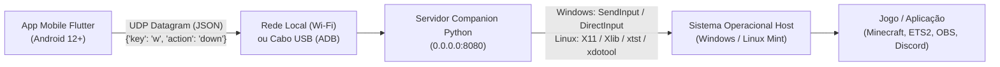

# Guia Técnico para Agentes de IA (AGENT.md)
> Este documento é a especificação técnica e o guia operacional definitivo para qualquer Agente de IA (Antigravity, Claude Code, GitHub Copilot, Cursor, etc.) ou desenvolvedor que for manter ou estender este repositório no **Linux Mint** ou no **Windows**.

---

## 1. Visão Geral e Arquitetura do Sistema

O projeto é um ecossistema customizável de controle remoto virtual estilo **Stream Deck**, desenhado para latência mínima e compatibilidade total com jogos de PC (DirectInput / X11).



### Componentes:
1. **Cliente Móvel (`app/`)**: Aplicativo Flutter (Android 12+) com grid responsivo de teclas, suporte a múltiplos modos (Generic F13-F24, Numpad, Six Pack e Custom Views personalizadas), haptic feedback e detecção automática de servidores na rede.
2. **Servidor Host (`server/`)**: Aplicação Python 3 com interface gráfica moderna em Tkinter, suporte a System Tray (ícones ocultos), auto-inicialização com o sistema e backend híbrido de injeção de hardware para Windows e Linux.
3. **Distribuição / Releases (`release/`)**: Binários compilados prontos para distribuição direta (APK Android, executável Windows e pacote `.deb` para Linux Mint/Ubuntu).

---

## 2. Protocolo de Comunicação e Rede

- **Transporte**: UDP (User Datagram Protocol) na porta `8080` (configurável).
- **Codificação**: UTF-8 em formato JSON.

### Mensagens de Teclado (Controle em Tempo Real):
```json
{
  "key": "w",
  "action": "down"
}
```
- `key`: Identificador da tecla sempre em **minúsculo** (ex.: `"w"`, `"space"`, `"f13"`, `"numpad_0"`).
- `action`: `"down"` (ao encostar/pressionar) ou `"up"` (ao soltar ou cancelar o gesto).

### Auto-Descoberta de Hosts (UDP Broadcast):
1. **App envia** broadcast UDP para `255.255.255.255`, loopback e subnets locais:
   ```json
   {
     "type": "discover",
     "client": "StreamDeckApp",
     "version": 1
   }
   ```
2. **Servidor responde** em unicast para o cliente:
   ```json
   {
     "type": "discover_ack",
     "server_name": "StreamDeck-Host",
     "ip": "192.168.1.50",
     "port": 8080,
     "protocol": "streamdeck_v1"
   }
   ```

---

## 3. Guia Operacional: Linux Mint / Ubuntu

No Linux Mint (e distribuições Debian/Ubuntu), o servidor suporta modo gráfico Tkinter e injeção de teclas em sessões X11.

### Instalação de Dependências do Sistema:
```bash
sudo apt update
sudo apt install -y python3-tk python3-pil python3-pip libxtst6 x11-xserver-utils xmodmap xdotool
```
*Nota: `x11-xserver-utils` e `xmodmap` são essenciais para que o método `_ensure_linux_f_keys()` do servidor mapeie dinamicamente os keycodes das teclas F13 a F24 no X11.*

### Instalação das Dependências Python:
```bash
cd server
pip3 install -r requirements.txt
```

### Executando o Servidor:
- **Modo Gráfico com Tray:**
  ```bash
  cd server
  python3 main.py
  ```
- **Modo Terminal / Headless:**
  ```bash
  cd server
  python3 main.py --cli
  ```

### Instalação via Pacote Debian Nativo (.deb):
O repositório já inclui o instalador empacotado em `release/linux/`:
```bash
sudo dpkg -i release/linux/streamdeck-server_1.0.0_all.deb
sudo apt-get install -f  # resolve eventuais dependências ausentes
```
O pacote instala o executável em `/usr/local/bin/streamdeck-server`, cria entrada de menu desktop com ícone de alta resolução e registra serviço de background se desejado.

---

## 4. Guia Operacional: Windows

### Injeção de Teclado a Nível de Hardware (DirectInput):
Motores gráficos DirectX e OpenGL (como *Minecraft*, *Euro Truck Simulator 2*, *Assetto Corsa*) ignoram eventos de teclado convencionais de alto nível gerados por bibliotecas como `pyautogui` ou `keyboard`.
- O servidor utiliza `pydirectinput` e `ctypes.windll.user32.SendInput` com scancodes de hardware específicos (`KEYEVENTF_SCANCODE`), garantindo que qualquer simulador ou jogo reconheça os inputs sem falhas.
- `AppUserModelID`: Definido como `io.github.streamdeck.host` para fixação correta do ícone na barra de tarefas do Windows.

### Executando o Servidor no Windows:
```powershell
cd server
py -3.11 main.py
# ou
python main.py
```

### Compilação do Executável Windows e Instalador Inno Setup:
1. **Compilar distribuição PyInstaller (`--onedir`):**
   ```powershell
   py -3.11 -m PyInstaller --noconfirm StreamDeckServer.spec
   # Gera a pasta com runtime e executável em dist/StreamDeckServer/
   ```
2. **Gerar Instalador Profissional com Inno Setup:**
   ```powershell
   & "C:\Users\<user>\AppData\Local\Programs\Inno Setup 6\ISCC.exe" server\installer.iss
   # O instalador de produção é gerado diretamente em release/windows/StreamDeckServer-Setup.exe
   ```

---

## 5. Sincronização entre Máquinas (Notebook / Desktop / Linux)

Ao alternar o desenvolvimento entre diferentes computadores ou sistemas operacionais (ex: do PC Desktop Windows para o Notebook com Linux Mint), execute sempre o comando para descartar resíduos locais e alinhar com a branch principal remota:

```bash
git fetch origin && git reset --hard origin/main
```

---

## 6. Comandos e Suíte de Testes

Antes de concluir qualquer alteração de código, **TODOS** os testes existentes devem ser executados e aprovados.

### Testes Unitários do Servidor Python:
- **No Linux Mint:**
  ```bash
  python3 -m unittest server/test_server.py
  ```
- **No Windows:**
  ```powershell
  py -3.11 -m unittest server/test_server.py
  # ou
  python -m unittest server/test_server.py
  ```
*Nota: A suíte testa ABI C `ctypes`, `SendInput`, detecção de IP, parsing de pacotes UDP, descoberta de rede e manipulação de registro.*

### Testes do App Flutter:
- **No Linux Mint / Windows:**
  ```bash
  cd app && flutter test
  ```
*No Windows (usando path local se flutter não estiver no PATH global):*
```powershell
cd app; & "C:\Dev\flutter\bin\flutter.bat" test
```
*A suíte testa o modelo `DiscoveredHost`, serviço `DiscoveryService`, layout dos botões `Generic`, `Numpad`, `Six Pack`, criação de Custom Views, responsividade mobile e ausência de render overflows.*

---

## 7. Regras de Ouro e Diretrizes para Agentes de IA

1. **NUNCA modifique ou enfraqueça testes para fazê-los passar**:
   - Se um teste falhar, investigue e corrija o código de produção.
2. **Preserve a lógica de toques no Flutter (`onTapDown` / `onTapUp` / `onTapCancel`)**:
   - Não converta os botões de ação para `ElevatedButton(onPressed: ...)`. O Stream Deck exige a capacidade de segurar teclas de forma contínua para jogos de corrida e direção.
3. **Ambiente de Teste no Flutter**:
   - `_autoDiscoverHost` é protegido com `if (!Platform.environment.containsKey('FLUTTER_TEST'))` para evitar que `CircularProgressIndicator` infinito bloqueie chamadas de `tester.pumpAndSettle()`. Mantenha essa proteção íntegra.
4. **Gerenciamento do Git e Arquivos Rastreados**:
   - **NUNCA** faça commit das pastas `build/`, `dist/`, `.dart_tool/`, `__pycache__/`, `app/android/.kotlin/` ou de caminhos absolutos do sistema operacional (`C:\Users\...`).
   - **SEMPRE** mantenha o diretório `release/` e seus binários versionados e rastreados no Git (`StreamDeck.apk`, `StreamDeckServer.exe`, `streamdeck-server_1.0.0_all.deb`, `install.sh`, `README.md`).
5. **Nomes de Teclas em Minúsculo**:
   - Os pacotes UDP e mapas de scancode esperam strings minúsculas (ex.: `"w"`, `"space"`, `"f14"`).
