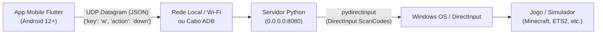

# WALKTHROUGH DO PROJETO - STREAM DECK CONTROLLER (MOBILE TO PC)
> **Documento de Contextualização e Guia Técnico para Agentes de IA e Desenvolvedores**

---

## 1. Objetivo do Projeto

O objetivo deste projeto é construir uma solução do tipo **Stream Deck customizável**, composta por:
1. Um **aplicativo móvel (Flutter/Android 12+)** que atua como um teclado virtual customizável em grid, capturando toques individuais e contínuos.
2. Um **servidor host companheiro no PC (Python/Windows)** que escuta os comandos em tempo real via rede e realiza **injeção de teclas a nível de hardware/DirectInput**.

### Problema Específico Resolvido
Motores gráficos de jogos para PC (especialmente títulos em DirectX e OpenGL, como *Minecraft*, *Euro Truck Simulator 2*, *Assetto Corsa*, etc.) ignoram eventos de teclado de alto nível simulados via APIs convencionais do Windows (como `pyautogui`, `keyboard` ou `SendKeys`). 

Este projeto resolve isso utilizando:
- **`pydirectinput`**: Simulação direta de scancodes de hardware via DirectInput / Win32 API (`ctypes`), garantindo que os jogos reconheçam as teclas.
- **Diferenciação precisa entre pressionar e soltar (`down` e `up`)**: Essencial para controles de jogos onde teclas precisam ser mantidas pressionadas (ex.: acelerar um caminhão com `W`, segurar freio de mão com `Space`).
- **Comunicação por UDP de baixíssima latência**: Evita overhead de handshakes TCP durante sessões de jogo.

---

## 2. Arquitetura do Sistema



### Protocolo de Mensagens
As mensagens são transmitidas como pacotes UDP codificados em UTF-8 no formato JSON:
```json
{
  "key": "w",
  "action": "down"
}
```
- `key`: Nome da tecla em minúsculo reconhecida pelo `pydirectinput` (`w`, `s`, `a`, `d`, `space`, `h`, `l`, `1`, etc.).
- `action`: `"down"` (ao encostar o dedo) ou `"up"` (ao soltar o dedo ou cancelar o gesto).

---

## 3. Estrutura de Diretórios e Alterações Realizadas

```text
keyboard_app/
│
├── WALKTHROUGH.md                          # [Novo] Este documento de orientação técnica
│
├── server/                                 # Servidor Host do PC
│   ├── requirements.txt                   # Dependências Python (pydirectinput)
│   └── main.py                            # Socket UDP, loop assíncrono e injeção DirectInput
│
└── app/                                    # Cliente Móvel Flutter
    ├── pubspec.yaml                       # Dependências do app (shared_preferences)
    ├── android/
    │   └── app/src/main/AndroidManifest.xml # Permissões de rede Android 12+
    ├── test/
    │   ├── discovery_test.dart            # Testes de integração e modelo de auto-descoberta
    │   └── widget_test.dart               # Testes de widgets, perfis e modos de teclas
    └── lib/
        ├── discovery_service.dart         # Serviço de UDP broadcast e busca de hosts
        └── main.dart                      # UI Grid, GestureDetector e gerenciamento de socket UDP
```

### Detalhamento das Alterações Feitas

#### A. Servidor Host Python (`server/`)
1. **`server/requirements.txt`**:
   - `pydirectinput==1.0.4` (injeção Win32 DirectInput)
   - `pystray>=0.19.5` (suporte a ícone na bandeja / ícones ocultos do sistema)
   - `Pillow>=9.5.0` (geração de ícones dinâmicos)
2. **`server/main.py`**:
   - **Interface Gráfica Integrada (`StreamDeckGUI`)**:
     - Botão Ligar/Desligar Servidor em tempo real sem fechar o programa.
     - Detecção automática e exibição em destaque do IPv4 local com botão de cópia de 1 clique (`📋 Copiar`).
     - Checkbox para alternar inicialização automática com o Windows via registro `HKCU\Software\Microsoft\Windows\CurrentVersion\Run`.
     - Monitor em tempo real do último comando e total de pacotes recebidos.
     - Suporte a execução em segundo plano / ícones ocultos (`pystray` + `root.withdraw()`).
     - Modos flexíveis: interface gráfica padrão, `--minimized` (para startup silencioso na bandeja) e `--cli` (para execução pura no terminal).
   - Injeção de hardware a nível de SO (`ctypes.windll.user32.SendInput` para teclas F13-F24, Numpad scancodes, navegação e multimídia).
   - Compatibilidade multiplataforma (Windows Win32 + Linux X11 fallback).
3. **`server/test_server.py`**:
   - 16 testes unitários cobrindo ABI C ctypes, SendInput, scancodes de Numpad e F13-F24, ciclo de vida do servidor UDP, detecção de IP e registro de inicialização.

#### B. App Flutter (`app/`)
1. **`app/pubspec.yaml`**:
   - Configurado para Dart SDK `>=3.0.0 <4.0.0`.
   - Dependência `shared_preferences: ^2.2.0` para armazenar localmente o endereço IP configurado pelo usuário.
2. **`app/android/app/src/main/AndroidManifest.xml`**:
   - Declaradas permissões obrigatórias para Android 12+:
     - `android.permission.INTERNET`
     - `android.permission.ACCESS_NETWORK_STATE`
     - `android.permission.ACCESS_WIFI_STATE`
3. **`app/lib/main.dart`**:
   - **Gerenciamento de Rede**: Inicialização de `RawDatagramSocket.bind(InternetAddress.anyIPv4, 0)` para envio sem bloqueio de thread.
   - **Lógica de Entrada (Crucial)**: Cada botão utiliza um `GestureDetector` com:
     - `onTapDown` ➔ emite `action: down`
     - `onTapUp` ➔ emite `action: up`
     - `onTapCancel` ➔ emite `action: up` (proteção contra "tecla presa" se o usuário arrastar o dedo para fora do botão).
   - **Interface e Configuração**:
     - Grid flexível com botões visuais customizados para simulação (Acelerar, Frear, Virar, Buzina, Farol, Freio de Mão).
     - Botão de engrenagem no AppBar que abre um modal para definir e persistir o IP do PC.

---

## 4. Guia de Execução

### No PC (Servidor Host)
1. Instale os requisitos:
   ```powershell
   cd c:\Users\gusta\OneDrive\Documentos\keyboard_app\server
   pip install -r requirements.txt
   ```
2. Execute o servidor:
   ```powershell
   python main.py
   ```
   *(Ou execute `python main.py --cli` se preferir modo terminal clássico sem interface gráfica).*
3. A interface abrirá exibindo o **IP do Computador** e o status **ATIVO**.
4. Para não ocupar espaço na barra de tarefas, clique em **"Minimizar para Ícones Ocultos"** (ou minimize/feche a janela). O servidor continuará escutando os comandos no plano de fundo na bandeja do Windows.
5. Marque a caixa **"Iniciar com o Windows"** caso deseje que o servidor suba automaticamente minimizado na bandeja ao ligar o PC.

### No Smartphone (App Flutter)
1. Gere os arquivos de build da plataforma (caso ainda não tenham sido gerados na máquina local):
   ```powershell
   cd c:\Users\gusta\OneDrive\Documentos\keyboard_app\app
   flutter create .
   ```
2. Execute o aplicativo:
   ```powershell
   flutter run
   ```
3. No app, clique no ícone de configurações (⚙️) no canto superior direito e informe o IP do computador.

> **Dica para Conexão via Cabo USB (ADB):**
> Se preferir jogar via cabo USB para latência zero absoluta e sem depender do Wi-Fi:
> ```powershell
> adb reverse tcp:8080 tcp:8080
> ```
> *(Nota: Para uso com cabo via `adb reverse`, alterne o transporte do app para TCP ou utilize porta redirecionada compatível).*

---

## 5. Diretrizes para Novos Agentes de IA

Ao continuar ou evoluir este repositório, atente-se às seguintes regras e restrições técnicas:

1. **NUNCA substitua `pydirectinput` por `pyautogui` ou `keyboard` comum:**
   - Jogos como Minecraft e Euro Truck Simulator utilizam DirectInput scancodes. Chamadas `SendInput` genéricas de SO são ignoradas por esses jogos.
2. **Preserve a separação estrita de `onTapDown` e `onTapUp` / `onTapCancel`:**
   - Não converta os botões para `ElevatedButton(onPressed: ...)` padrão do Flutter, pois o `onPressed` dispara apenas um clique atômico após soltar o dedo, impossibilitando manter um acelerador ou botão pressionado.
3. **Mantenha os identificadores de teclas em minúsculo:**
   - A biblioteca `pydirectinput` no Windows espera mapeamentos como `'w'`, `'space'`, `'shift'`, `'f'`, `'1'`.
4. **Regras ao editar arquivos Dart/Flutter no workspace:**
   - Se houver uma instância do app em execução, conecte-se via DTD e execute hot reload para validar as alterações.
   - Caso o app não esteja em execução, prossiga normalmente com as modificações de código sem bloquear a tarefa.

---

## 6. Próximos Passos Sugeridos / Backlog de Evolução

- [x] **Feedback Háptico**: Adicionar `HapticFeedback.lightImpact()` ao tocar nos botões do Flutter.
- [x] **Múltiplos Perfis / Layouts**: Permitir alternar layouts pré-definidos (Generic F13-F24, Numpad, Six Pack e Custom Views).
- [x] **Descoberta Automática de Host**: Implementado via UDP Broadcast bidirecional (Auto-Discovery no boot, modal interativo e suporte a subnet broadcast).
- [ ] **Suporte a Macros**: Permitir envio de combinações de teclas sequenciais com temporizador configurável.
